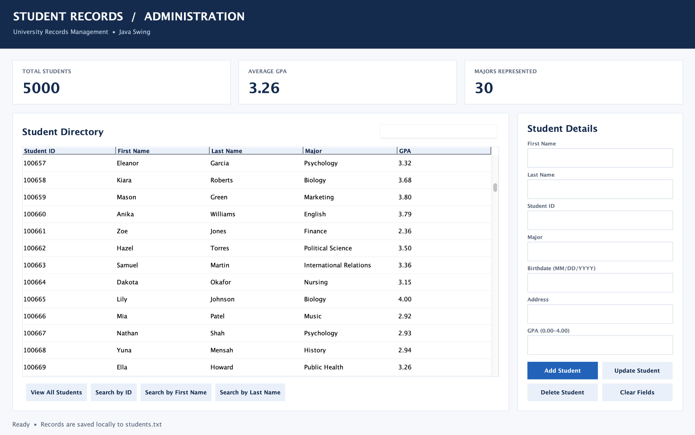

# Student Records Administration Dashboard

A Java-based university administration dashboard developed using **Java Swing**, object-oriented programming, and file I/O.

The application manages a simulated university dataset containing **5,000 fictional student records across 30 academic majors**, providing an interactive interface for managing student information, searching records, and monitoring academic statistics.

This project began as a student database management application and was expanded into a dashboard-style desktop application with AI-assisted interface development.

## Dashboard Preview



The dashboard provides an overview of university enrollment information, including student records, GPA statistics, and academic major distribution.

### Dashboard Highlights

- **5,000 Student Records** — Simulated university enrollment dataset
- **30 Academic Majors** — Multiple academic disciplines represented
- **3.26 Average GPA** — Calculated from the fictional student dataset
- **Interactive Student Directory** — Scrollable and sortable student records
- **Student Details Panel** — View and manage individual student information

## Project Objectives

The objective of this project was to develop a functional student records management application while demonstrating practical Java programming and data management concepts.

Key objectives included:

- Implementing Create, Read, Update, and Delete (CRUD) operations
- Developing an interactive graphical user interface
- Managing persistent student data using text-file storage
- Validating user input and preventing duplicate student IDs
- Calculating and displaying summary statistics
- Testing application functionality with a larger simulated dataset

## Technologies & Skills

| Technology | Application |
|------------|-------------|
| Java | Core application development |
| Java Swing | Graphical user interface |
| Object-Oriented Programming | Student models and application structure |
| File I/O | Reading and writing student records |
| ArrayList | Managing student records in memory |
| CRUD Operations | Creating, retrieving, updating, and deleting records |
| Input Validation | Validating student information |
| GitHub | Source code management and documentation |

## Key Features

### Student Record Management

The application supports the following operations:

- Add new student records
- View existing student information
- Update student details
- Delete student records with confirmation
- Prevent duplicate student IDs
- Validate GPA values and birthdate formatting

### Student Search & Directory

Users can locate student records through:

- Student ID searches
- First-name searches
- Last-name searches
- Searchable student directory
- Sortable table columns

### Academic Summary Statistics

The dashboard automatically calculates:

- Total number of student records
- Average student GPA
- Number of unique academic majors

These metrics provide a quick overview of the simulated university dataset.

## Dataset Overview

The application uses a synthetic dataset containing 5,000 fictional students across 30 academic majors.

Each record includes:

- First name
- Last name
- Student ID
- Academic major
- Birthdate
- Address
- GPA

Records are stored in `students.txt` using a pipe-delimited format.

Example:

```text
Alex|Morgan|100001|Computer Science|02/14/2004|Boston MA|3.7
```

The dataset was expanded to evaluate how the application handles larger record collections, table navigation, searching, and academic summary calculations.

**All student information is fictional and intended for demonstration purposes.**

## Technical Implementation

### Application Architecture

The application separates responsibilities across four Java classes:

**Main.java**
- Initializes the application
- Launches the Java Swing interface

**Student.java**
- Represents individual student records
- Defines student attributes
- Supports record serialization

**StudentDatabase.java**
- Handles student record storage
- Implements CRUD operations
- Reads and writes data to `students.txt`
- Supports searching and validation

**StudentGUI.java**
- Builds the dashboard interface
- Displays student records using Swing components
- Handles user interactions
- Updates dashboard statistics and table contents

### Data Persistence

Student records are stored locally in a text file rather than a traditional relational database.

The application reads records when launched and writes changes back to the file, allowing student information to persist between sessions.

### Data Validation

Validation measures include:

- Duplicate student ID prevention
- GPA range validation (0.00–4.00)
- Birthdate format validation
- Required field checks
- Delete confirmation prompts

## How to Run

**Requirements:** Java 11 or newer.

1. Clone or download this repository.
2. Open the project folder in a terminal.
3. Compile the Java source files:

```bash
javac Main.java Student.java StudentDatabase.java StudentGUI.java
```

4. Launch the application:

```bash
java Main
```

The dashboard loads student records from `students.txt` in the working directory.

## Project Structure

```text
java-student-records-management-system/
├── Main.java
├── Student.java
├── StudentDatabase.java
├── StudentGUI.java
├── students.txt
├── README.md
├── .gitignore
└── screenshots/
    └── student_dashboard.png
```

## Development & Learning Outcomes

Through this project, I explored the practical application of Java programming concepts in a desktop management system.

The project demonstrates:

- Building interactive desktop applications using Java Swing
- Structuring application logic using object-oriented programming
- Implementing CRUD operations and persistent file storage
- Managing and displaying structured student information
- Calculating academic summary statistics
- Testing application functionality with thousands of simulated records

The dashboard redesign and portions of the implementation were developed with AI assistance, building on an earlier student management application.

## Limitations & Future Improvements

This application is intended as a portfolio and educational project rather than a production university information system.

Current limitations include:

- Plain-text storage rather than a relational database
- No authentication or user access controls
- No multi-user synchronization
- No encryption for stored records

Potential future improvements include migrating to SQLite or MySQL, introducing role-based authentication, and optimizing record retrieval for larger datasets.

## Data Privacy

All included student records are synthetic. No real student records or Social Security numbers are included in the public dataset.
